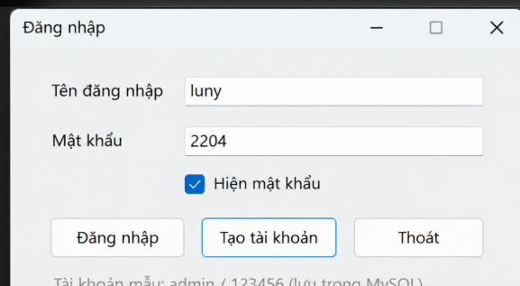
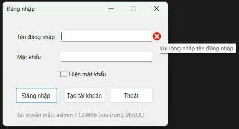
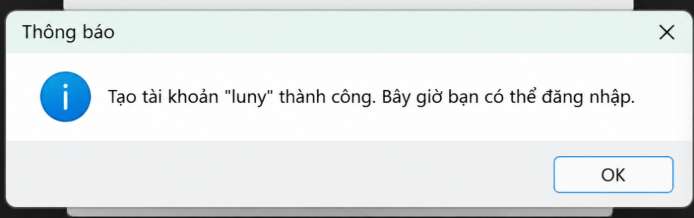
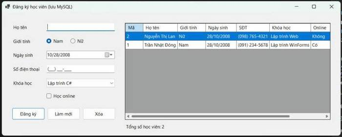
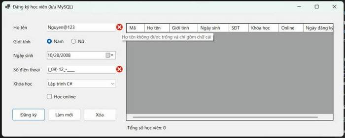
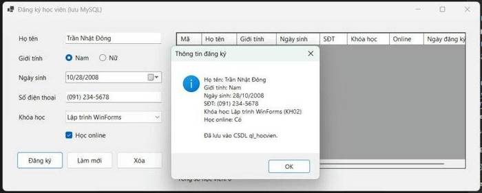

# Bài tập 5 – Ứng dụng WinForms lưu trữ CSDL MySQL (nâng cấp Bài 4.1 và 4.2)

**Sinh viên:** Trần Thế Hào – MSSV 24810320120 – Lớp D19QTANM1 – Lập trình .NET

## Tổng quan

Bài tập 5 nâng cấp hai bài tập ở Bài 4: thay vì chỉ xử lý trên giao diện và in kết quả ra `MessageBox`, dữ liệu được **lưu trữ và truy vấn từ CSDL MySQL**.

| Bài | Nâng cấp từ | Nội dung | Dự án | CSDL |
|-----|-------------|----------|-------|------|
| **5.1** | Bài 4.1 | Form đăng nhập, kiểm tra tài khoản thật trong CSDL | `BaiTap5_1_LoginForm` | `ql_dangnhap` |
| **5.2** | Bài 4.2 | Form đăng ký học viên, lưu và quản lý danh sách | `BaiTap5_2_DangKyHocVien` | `ql_hocvien` |

## Cấu trúc thư mục

```
.
├── README.md
├── 5.1/                              # Bài 5.1 – Login Form
│   ├── BaiTap5_1_LoginForm.csproj
│   ├── Database.cs
│   ├── database.sql
│   └── docs/                         # Ảnh minh họa bài 5.1
└── 5.2/                              # Bài 5.2 – Đăng ký học viên
    ├── BaiTap5_2_DangKyHocVien.csproj
    ├── Database.cs
    ├── database.sql
    └── docs/                         # Ảnh minh họa bài 5.2
```

| Bài | Thư mục | Dự án | Chuỗi kết nối | Script CSDL |
|-----|---------|-------|---------------|-------------|
| 5.1 | [5.1/](5.1/) | [BaiTap5_1_LoginForm.csproj](5.1/BaiTap5_1_LoginForm.csproj) | [Database.cs](5.1/Database.cs) | [database.sql](5.1/database.sql) |
| 5.2 | [5.2/](5.2/) | [BaiTap5_2_DangKyHocVien.csproj](5.2/BaiTap5_2_DangKyHocVien.csproj) | [Database.cs](5.2/Database.cs) | [database.sql](5.2/database.sql) |

**Đặc điểm chung của cả hai bài**

- Công nghệ: C# WinForms (.NET 10), MySQL (XAMPP), thư viện `MySqlConnector`.
- Mọi truy vấn đều dùng **tham số** (ví dụ `@u`, `@p`) để chống SQL Injection.
- Dữ liệu nhập được kiểm tra bằng `ErrorProvider`.
- Chương trình **tự tạo CSDL, bảng và dữ liệu mẫu** khi chạy lần đầu, không cần cấu hình thủ công.
- Giữ nguyên toàn bộ yêu cầu của bài gốc (Bài 4.1 và 4.2).

---

## Bài 5.1 – Login Form lưu trữ CSDL (nâng cấp Bài 4.1)

Bài 4.1 chỉ kiểm tra ô trống rồi báo "Đăng nhập thành công". Bài 5.1 lưu tài khoản trong MySQL và kiểm tra đăng nhập thật.

### Yêu cầu giữ nguyên từ Bài 4.1
- Các control: `txtUsername`, `txtPassword`, `chkShowPassword`, `btnLogin`, `btnExit`, `errorProvider`.
- Enter = Đăng nhập (`AcceptButton`), Esc = Thoát (`CancelButton`).
- Không được để trống tên đăng nhập và mật khẩu (báo lỗi bằng `ErrorProvider`).

### Nội dung nâng cấp
- **CSDL `ql_dangnhap`**
  - `TaiKhoan`: tên đăng nhập, mật khẩu đã băm **SHA-256** (không lưu mật khẩu gốc), họ tên, ngày tạo.
  - `LichSuDangNhap`: ghi lại mọi lần đăng nhập thành công / thất bại.
- Nút **Tạo tài khoản** thêm tài khoản mới vào CSDL (mật khẩu ≥ 6 ký tự, báo lỗi nếu trùng tên).
- Sai mật khẩu 3 lần thì chương trình tự đóng.
- Tài khoản mẫu: **admin / 123456**

### Hình ảnh minh họa

**1. Giao diện bình thường** – nhập tài khoản, tick "Hiện mật khẩu" để xem mật khẩu.



**2. Nhập lỗi** – để trống tên đăng nhập rồi bấm Đăng nhập, `ErrorProvider` báo lỗi cạnh ô nhập.



**3. Thêm tài khoản thành công** – bấm "Tạo tài khoản", tài khoản mới được lưu vào bảng `TaiKhoan` trong MySQL.



**4. Đăng nhập thành công** – mật khẩu được kiểm tra với dữ liệu trong CSDL.


---

## Bài 5.2 – Form đăng ký học viên lưu trữ CSDL (nâng cấp Bài 4.2)

Bài 4.2 chỉ in thông tin đăng ký ra `MessageBox`, danh sách khóa học viết cứng trong code. Bài 5.2 lưu toàn bộ vào MySQL.

### Yêu cầu giữ nguyên từ Bài 4.2
- `mtxtPhone` dùng mask `(000) 000-0000`.
- `dtpBirthDate` định dạng Short.
- `cboCourse` binding bằng `DisplayMember` / `ValueMember`.
- RadioButton chọn giới tính, CheckBox học online.
- Nút **Đăng ký** tổng hợp thông tin lên `MessageBox`.

### Nội dung nâng cấp
- **CSDL `ql_hocvien`**
  - `KhoaHoc` (MaKH, TenKH): `cboCourse` nạp danh sách từ bảng này.
  - `HocVien` (họ tên, giới tính, ngày sinh, SĐT, mã khóa học – khóa ngoại tới `KhoaHoc`, học online, ngày đăng ký).
- Nút **Đăng ký** → `INSERT` học viên vào CSDL, rồi cập nhật lưới.
- **DataGridView** hiển thị danh sách học viên đã đăng ký (JOIN với `KhoaHoc`), có nút **Xóa** (xác nhận Yes/No) và **Làm mới**.
- Kiểm tra dữ liệu: họ tên không trống và chỉ chứa chữ cái; số điện thoại phải nhập đủ.
- Tự tạo 3 khóa học mẫu khi chạy lần đầu.

### Hình ảnh minh họa

**1. Giao diện bình thường** – danh sách học viên đọc từ CSDL hiển thị trên DataGridView.



**2. Nhập lỗi** – họ tên có ký tự đặc biệt, số điện thoại chưa đủ, `ErrorProvider` báo lỗi cạnh từng ô.



**3. Thêm học viên thành công** – bấm "Đăng ký", thông tin được tổng hợp lên `MessageBox` và lưu vào bảng `HocVien`.



---

## Cách chạy (áp dụng cho cả hai bài)

1. Cài XAMPP, mở **XAMPP Control Panel** → **Start MySQL** (mặc định user `root`, không mật khẩu, cổng 3306).
2. Mở file dự án bằng Visual Studio 2022+ (.NET 10):
   - Bài 5.1: [5.1/BaiTap5_1_LoginForm.csproj](5.1/BaiTap5_1_LoginForm.csproj)
   - Bài 5.2: [5.2/BaiTap5_2_DangKyHocVien.csproj](5.2/BaiTap5_2_DangKyHocVien.csproj)

   NuGet sẽ tự tải gói `MySqlConnector`.
3. Nhấn **F5**. (Tùy chọn: chạy [5.1/database.sql](5.1/database.sql) và [5.2/database.sql](5.2/database.sql) trong phpMyAdmin để tạo CSDL thủ công.)

> Nếu MySQL có đặt mật khẩu, sửa chuỗi kết nối trong [5.1/Database.cs](5.1/Database.cs) và [5.2/Database.cs](5.2/Database.cs).
